# Luồng mua vé → thanh toán → vào cổng bằng một QR cho cả đơn

Tài liệu này mô tả luồng chính của Tickey theo từng vai (Khách hàng, Nhân viên soát vé, Ban tổ chức, Admin nền tảng), kèm ảnh chụp từ lần chạy thật trên môi trường local ngày 01/11/2026.

**Thay đổi chính:** một đơn mua nhiều vé giờ có **một mã QR chung**. Nhân viên quét mã đó và chọn số người vào trong lượt quét. Server đếm số lượt đã dùng và còn lại, chặn việc cho vào quá số vé, và chặn mã giả.

## Tóm tắt luồng

```
Khách                         Server (.NET API + Workers)                Database (Supabase)
─────                         ───────────────────────────                ───────────────────
Chọn suất, chọn 3 ghế  ─────────────────────────────────────────────▶  create_booking → PENDING (giữ chỗ 10')
Thanh toán             ──▶  POST /payments/sessions ──────────────────▶  begin_payment → PAYMENT_PENDING
Cổng thanh toán (TEST) ──▶  /payments/test → apply_payment_success ───▶  PAID + outbox ISSUE_TICKETS
                            IssueTicketsWorker:
                              issue_tickets ───────────────────────────▶  tạo 3 vé ISSUED
                              issue_booking_credential + ký Ed25519 ──▶  booking_credentials (QR đơn, v2)
                              attach_ticket_credentials ───────────────▶  CONFIRMED
Xem vé                 ──▶  GET /api/bookings/{id}/admission ─────────▶  get_booking_admission → QR + 3 lượt

Nhân viên
─────────
Quét QR, chọn N người  ──▶  POST /api/check-in/scan
                              xác minh chữ ký QR bằng signing_keys
                              v2 (QR đơn) ──────────────────────────────▶  check_in_booking: khóa đơn, cho vào N vé
                              v1 (QR vé lẻ) ────────────────────────────▶  check_in (như cũ)
```

Nội dung QR có dạng `base64url(payload) + "." + chữ ký`. Payload chỉ chứa id: `{"v":2,"bid":<đơn>,"sid":<suất>,"kid":<khóa>,"iat":...}`.

---

## 1. Khách hàng (app mobile)

| # | Bước | Ảnh |
|---|---|---|
| C01 | Trang chủ, chọn sự kiện | 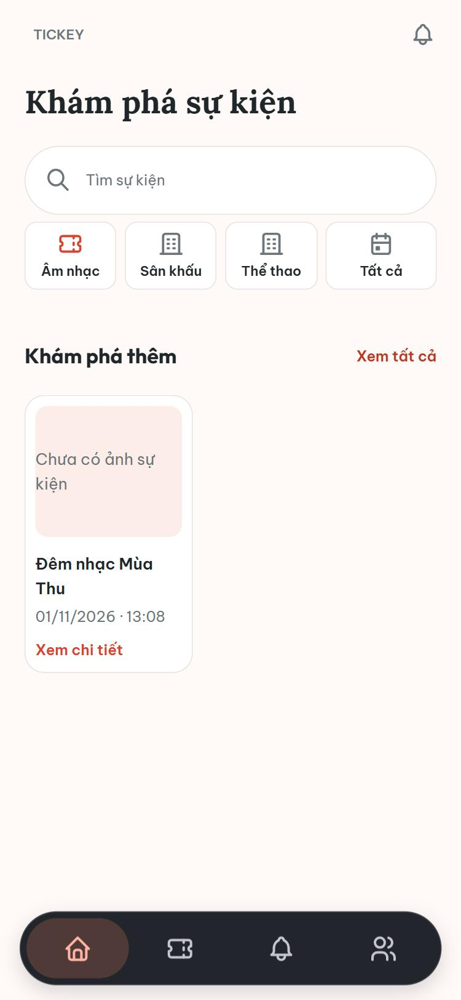 |
| C02 | Đăng nhập (`customer-1@dev.local`) | 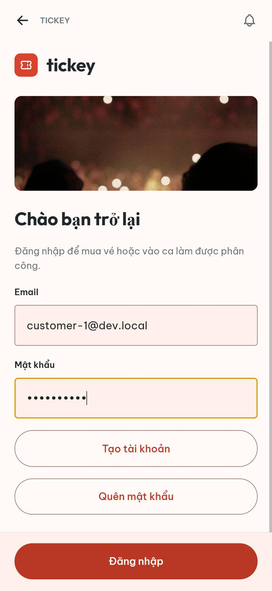 |
| C03 | Chi tiết sự kiện, bấm **Đặt vé** | 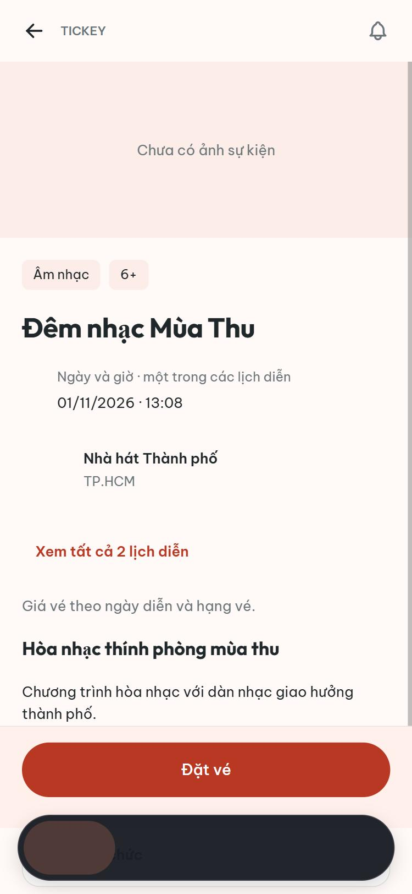 |
| C04 | Chọn suất diễn (Đêm 1) | 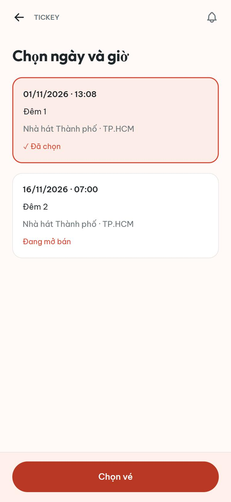 |
| C05 | Chọn 3 ghế VIP (A-3, A-4, A-5), tạm tính 4.500.000đ | 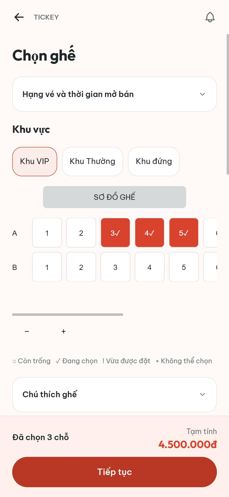 |
| C06 | Kiểm tra đơn: giữ chỗ 10 phút, mã đơn `177A2E1A2A` | 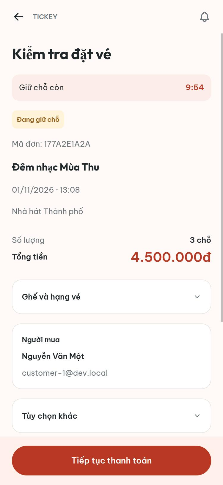 |
| C07 | Thanh toán: đồng ý điều khoản, bấm **Thanh toán** | 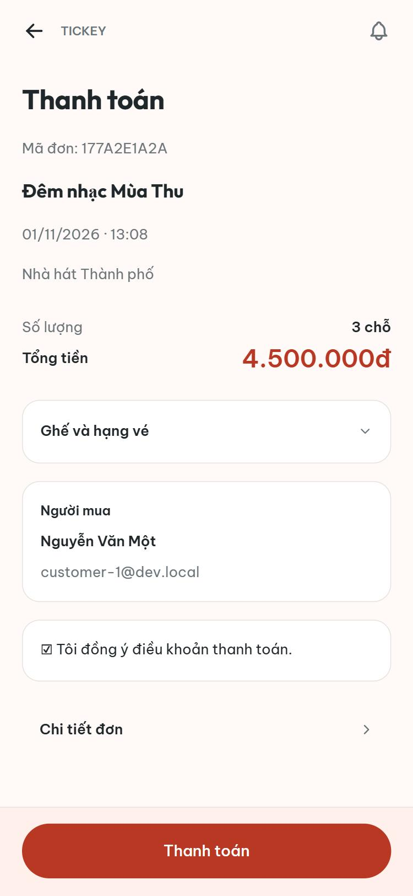 |
| C08 | Cổng thanh toán thử (chế độ TEST, không trừ tiền), bấm **Thanh toán thành công** | 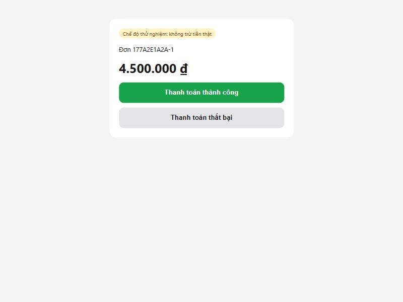 |
| C09 | **Vé vào cổng:** một QR cho cả đơn, đã vào 0, còn 3 lượt | 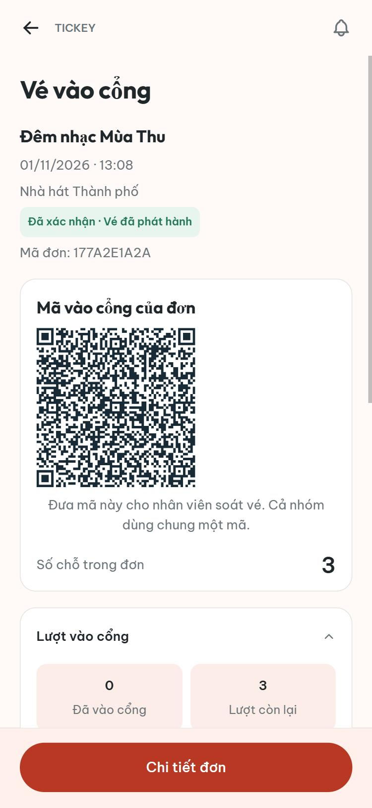 |
| C10 | Sau khi cả nhóm vào cổng: đã vào 3, còn 0. QR được ẩn | 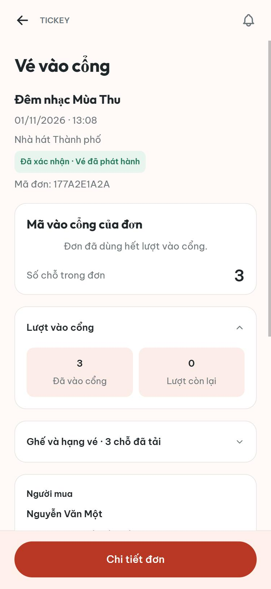 |

Ghi chú:
- Số lượt đã vào / còn lại luôn do server trả về (`GET /api/bookings/{id}/admission`). App không tự suy ra từ cache.
- Khi bấm **Lưu đơn để xem offline**, app lưu kèm QR của đơn, nên vẫn mở được mã ở cổng khi mất mạng. Lúc offline, số lượt hiện `—`.
- Đơn đã `CONFIRMED` trước bản này được worker ký bù QR đơn: `20261101000001_backfill_booking_credentials.sql` đưa job `ISSUE_TICKETS` cũ của các đơn chưa có QR (suất diễn chưa kết thúc) về `PENDING`. Gọi `enqueue` không có tác dụng, vì mỗi đơn chỉ được có một job `ISSUE_TICKETS` (C-11).

## 2. Nhân viên soát vé (app mobile, chế độ Staff)

| # | Bước | Ảnh |
|---|---|---|
| S01 | Đăng nhập `staff-a@dev.local`, vào ca **Đêm 1 · Cổng chính (VIP, Thường)** | 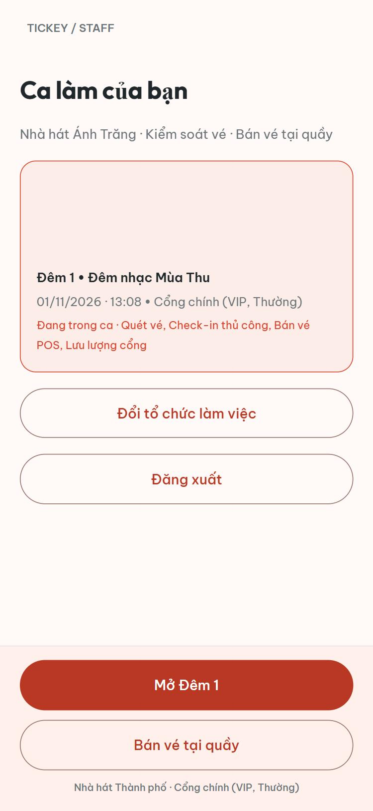 |
| S02 | Quét QR của khách (hoặc dán mã), chọn **2 người**, bấm **Cho vào 2 người**. Kết quả: vào 2/3, còn 1 lượt, ghế VIP-A-3 và VIP-A-4 | 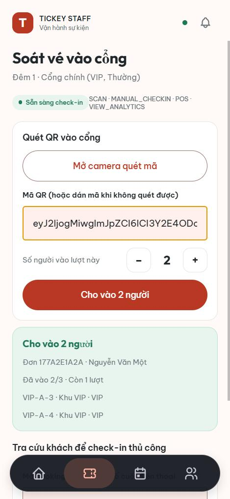 |
| S03 | Thử cho thêm 2 người nhưng đơn chỉ còn 1 lượt: bị chặn, **không ghi gì** | 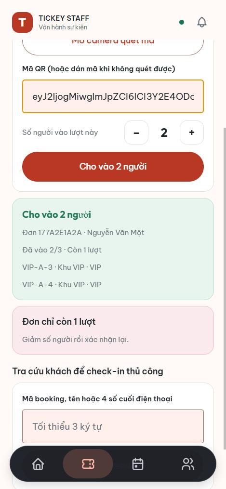 |
| S04 | Giảm còn 1, cho người thứ 3 vào: vào 3/3, còn 0 | 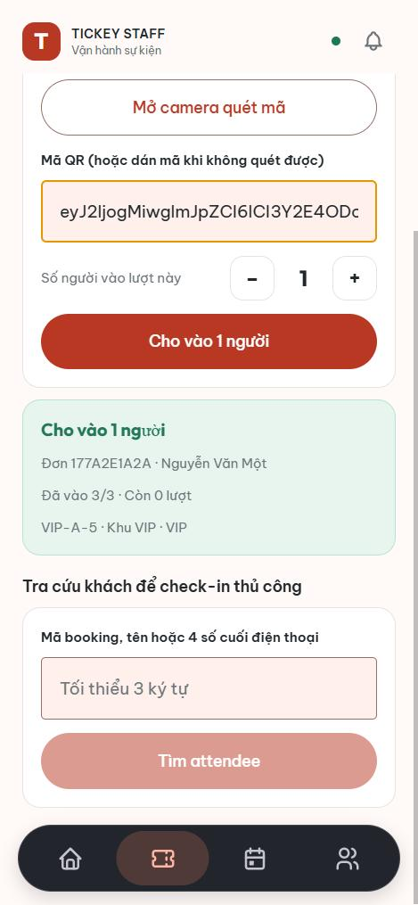 |
| S05 | Quét lại cùng mã: **Mã đã dùng hết lượt** | 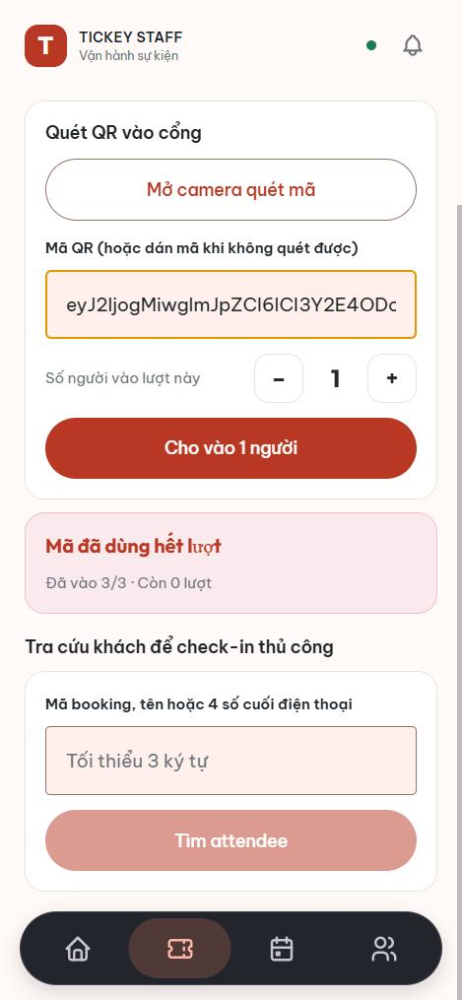 |
| S06 | Mã bị sửa chữ ký: **Mã QR không hợp lệ** | 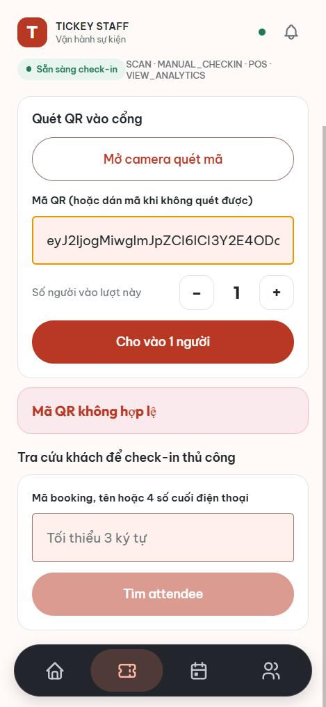 |

Quy tắc server áp dụng (`check_in_booking`):
- Khóa đơn khi quét. Hai máy quét cùng một QR sẽ xếp hàng, không thể cho vào quá số vé.
- Mỗi lần bấm có một `clientScanId`. Nếu mạng chập chờn và app gửi lại, server trả kết quả cũ và không trừ thêm lượt.
- Chỉ cho vào những vé `ISSUED` thuộc khu được phép ở cổng đang đứng. Nếu đơn chỉ có vé khu khác thì trả `WRONG_ZONE` kèm danh sách cổng đúng.
- Vé đã hoàn hoặc hủy (`VOID`, `REFUND_*`) không được tính là lượt.
- Ngoài giờ mở cổng trả `OUTSIDE_TIME`. Mọi lần cho vào và mọi lần từ chối đều ghi vào `scan_logs`.
- QR vé lẻ kiểu cũ (v1) vẫn quét được qua cùng endpoint.

## 3. Ban tổ chức (portal web)

| # | Bước | Ảnh |
|---|---|---|
| O01 | Đăng nhập `owner-a@dev.local` | 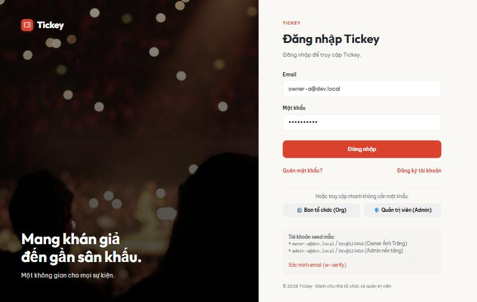 |
| O02 | Tổng quan: số dư quỹ 4.275.000đ (đơn 4.500.000đ sau phí nền tảng), 2 suất đang bán | 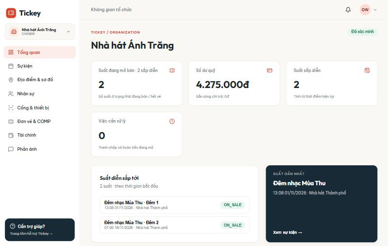 |
| O03 | Đơn vé khách hàng: đơn `177A2E1A2A`, 3 ghế VIP, đã xác nhận | 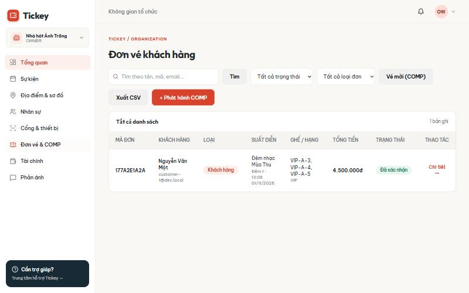 |
| O04 | Chi tiết đơn: ghế, hạng vé, thanh toán | 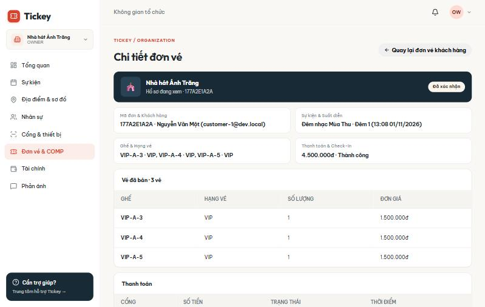 |
| O05 | Cổng soát vé: G1 (VIP, Thường), G2 (Khu đứng) | 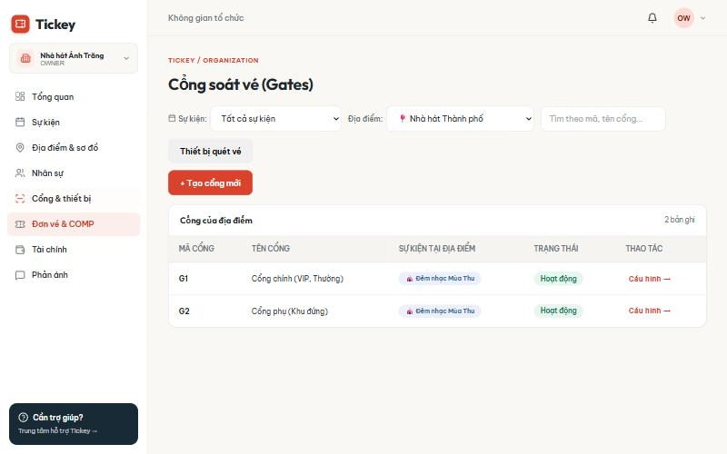 |

## 4. Admin nền tảng (portal web)

| # | Bước | Ảnh |
|---|---|---|
| A01 | Đăng nhập `admin@dev.local`, trang tổng quan nền tảng | 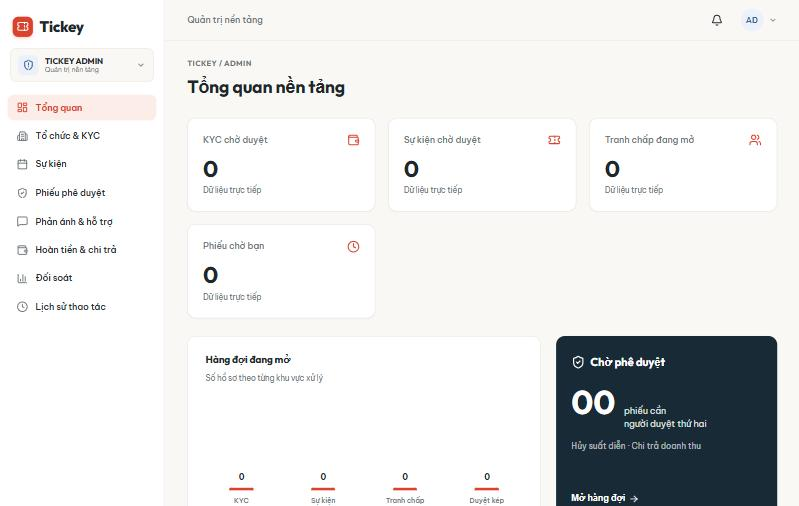 |
| A02 | Kiểm duyệt sự kiện: "Đêm nhạc Mùa Thu" đã phát hành. Sự kiện phải được Admin duyệt thì mới mở bán | 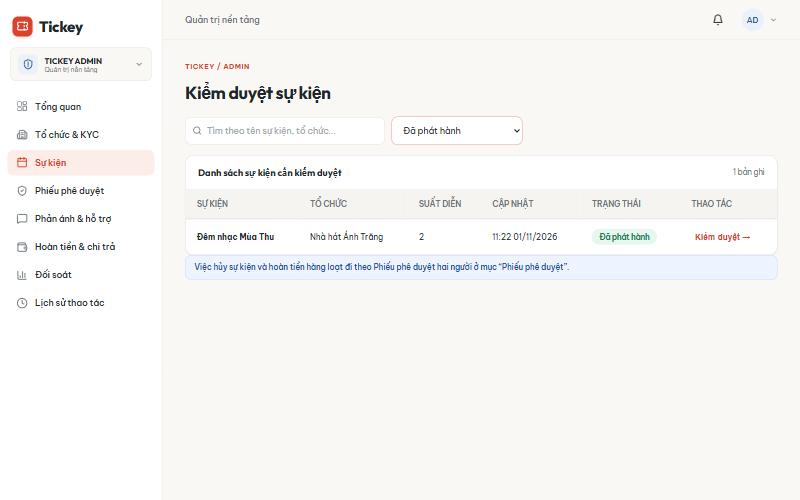 |
| A03 | Hồ sơ KYC tổ chức: hai tổ chức đã được duyệt | 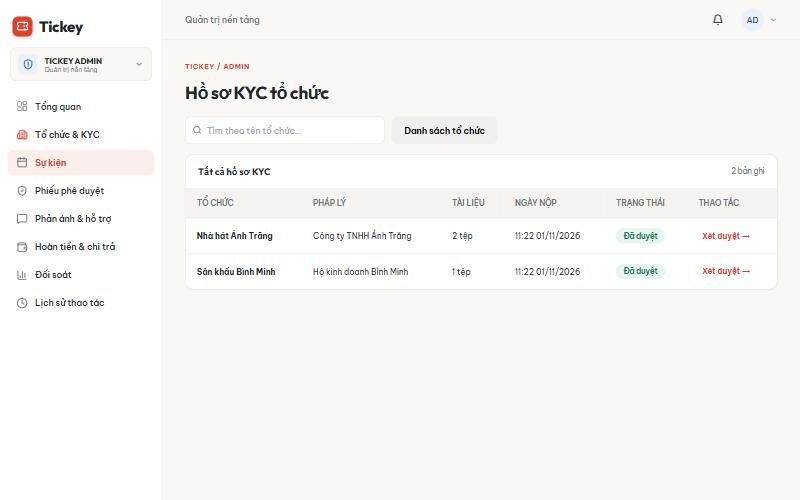 |

---

## Những gì đã thay đổi trong code

| Tầng | File | Nội dung |
|---|---|---|
| DB | `supabase/migrations/20261101000000_booking_admission_pass.sql` | Bảng `booking_credentials` (RLS: chỉ chủ đơn). RPC server `issue_booking_credential`, `attach_booking_credential`. RPC `get_booking_admission` cho khách và `check_in_booking` cho staff. Ký bù QR cho đơn cũ |
| DB test | `supabase/tests/database/05_booking_admission.test.sql`, `01_schema_rules.test.sql` | 16 test pgTAP: phát QR, RLS, cho vào N người, gửi lại không trừ thêm lượt, vượt lượt, hết lượt, sai cổng, log |
| Worker | `backend/src/EventPlatform.Core/Outbox/IssueTicketsWorker.cs` | Ký QR đơn trước khi gắn chữ ký vé, nên đơn đã `CONFIRMED` luôn có QR |
| API | `BookingEndpoints.cs`, `CheckInEndpoints.cs`, `Core/Qr/AdmissionCode.cs` | `GET /api/bookings/{id}/admission`, `POST /api/check-in/scan` (xác minh Ed25519 ở server) |
| Core | `packages/core/src/models/customer.ts`, `repositories/customer-repository.ts` | `admissionSchema`, `customer.admission()` |
| App khách | `features/customer/tickets/*`, `booking-result-screen.tsx` | Hiện QR đơn kèm số lượt. Lưu QR khi lưu đơn offline |
| App staff | `features/staff/components/staff-scanner.tsx`, `staff-check-in-screen.tsx`, `lib/staff-api.ts` | Máy quét camera (`expo-camera`) kèm ô dán mã, chọn số người, hiển thị kết quả |

## Chạy lại luồng này trên máy local

1. `npx supabase start` (cần Docker), rồi `npx supabase db reset`.
2. Tạo khóa ký QR cho local (DB_INSTRUCTIONS §4.1) và chèn public key vào `signing_keys`.
3. Chạy API với `Payments__Gateway=TEST`, `Payments__Test__AllowCheckout=true`, `Payments__Test__HmacKey`, `Qr__SigningKey`, `Qr__Kid`, `Api__PublicUrl=http://localhost:5080` và các key Supabase local.
4. Để demo soát vé ngay trong ngày, dời giờ suất "Đêm 1" và cửa sổ phân công của staff trên **DB local**: `doors_open_at` < bây giờ < `sales_end_at`.
5. Sau khi đồng bộ nhánh Customer, app xác nhận trực tiếp qua adapter TEST hiện có của API, không cần EXPO_PUBLIC_PAYMENT_GATEWAY và không mở trang cổng trung gian. Các ảnh C07/C08 ở trên ghi lại lần demo trước thay đổi này. Không dùng tên gateway khác để vượt qua điều kiện của UI. Xem `apps/mobile/PAYMENT_TESTING.md` để biết luồng hiện tại và blocker C-12 trên hosted.
6. Trên web không có camera: dán nội dung QR vào ô "Mã QR" ở màn Soát vé.

## Lưu ý khi đưa lên môi trường hosted

- Hosted đã có các migration đến `20261101000000` (kiểm tra catalog ngày 01/11/2026). Cần áp thêm `20261102000000_assign_staff_upsert.sql`, rồi chạy `notify pgrst, 'reload schema';`.
- Sau `20261101000000`, cần áp thêm `20261101000001_backfill_booking_credentials.sql`. Khi đó worker đang giữ khóa `hosted-1` sẽ ký bù QR cho các đơn đã `CONFIRMED`.
- Các bản build mobile cũ không có màn QR đơn. Cần build lại app vì có thêm plugin `expo-camera`.
